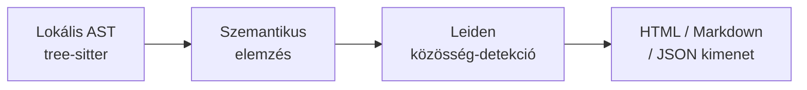

---
tags:
  - ai
  - knowledge-graph
  - python
  - mcp
  - developer-tool
datum: 2026-06-14
szint: "🧱 Scout"
kapcsolodo:
  - "[[toolbox/claude-code|Claude Code]]"
  - "[[toolbox/mcp-model-context-protocol|MCP]]"
  - "[[toolbox/opencode|OpenCode]]"
---

# Graphify

**URL:** https://github.com/safishamsi/graphify

> [!tldr] Egy mondatban
> A Graphify a kódbázisodat, dokumentációdat és sémáidat lekérdezhető tudásgráffá alakítja — hogy AI asszisztensek (Claude Code, Cursor, Aider stb.) természetes nyelven tudjanak kérdezni az egész projektedről.

---

## Mi ez és mire jó?

A **Graphify** egy Python-alapú eszköz, ami a teljes projektedet elemzi és egy szemantikus tudásgráfot épít belőle. A kódot lokálisan, API-hívás nélkül dolgozza fel (tree-sitter alapú AST-elemzés), dokumentumokhoz és képekhez viszont LLM-et hív.

A gráf ezután:
- **lekérdezhető** (`graphify query "mi köti össze az auth-ot az adatbázissal?"`)
- **vizualizálható** (interaktív HTML vagy Mermaid)
- **megosztható** — commitolható a repóba, a csapat többi tagja is használhatja
- **[[toolbox/mcp-model-context-protocol|MCP]]-szerveren keresztül** csatlakoztatható bármelyik AI asszisztenshez

---

## Hogyan működik?



1. **Lokális AST-kinyerés** — 36 programozási nyelv, SQL-séma, PDF, kép, videó feldolgozása; kódhoz nincs API-hívás
2. **Szemantikus elemzés** — dokumentumok és képek esetén LLM értelmezi a kontextust
3. **Közösség-detekció** — Leiden-algoritmus csoportosítja az összefüggő fogalmakat
4. **Kimenet generálás** — interaktív HTML gráf, Markdown riport, lekérdezhető JSON

---

## Fő képességek

| Funkció | Leírás |
|---|---|
| Multi-format elemzés | 36 nyelv + SQL + PDF + kép + videó |
| God nodes | Erősen összekötött csomópontok azonosítása (architekturális kulcspontok) |
| Confidence scoring | Kapcsolatok jelölése: EXTRACTED / INFERRED / AMBIGUOUS |
| Szemantikus query | `graphify query "..."` - természetes nyelvű keresés a gráfban |
| MCP szerver | Megosztott gráf-hozzáférés AI asszisztenseknek |
| Export | `callflow-html`, Markdown riport, JSON |
| Team sharing | Gráf commitolható gitbe, mindenki ugyanazt látja |

---

## Telepítés és használat

```bash
# Telepítés (uv ajánlott)
uv tool install graphifyy

# Inicializálás
graphify install

# Gráf építés az aktuális mappából
/graphify .

# Szemantikus query
graphify query "auth flow magyarázat"
graphify query "mi köti össze a payment modult az adatbázissal?"

# Vizualizáció exportálás
graphify export callflow-html
```

> [!warning] Névírás
> A csomag neve `graphifyy` (dupla y) az npm/PyPI-on — a `graphify` csomagnév foglalt volt.

---

## AI asszisztens integráció

A Graphify MCP-szervere 20+ AI asszisztenssel működik együtt:

- [[toolbox/claude-code|Claude Code]], Cursor, GitHub Copilot, Gemini CLI, Aider, és mások

MCP szerver hozzáadása [[toolbox/claude-code|Claude Code]]-hoz:

```bash
# A graphify install automatikusan konfigurálja az MCP szervert
graphify install

# Ezután Claude Code-ban elérhető a /graphify parancs
/graphify .
```

> [!tip] Workflow
> Onboarding esetén: `graphify query "mutasd be a rendszer architektúráját"` — azonnali áttekintés egy ismeretlen kódbázishoz.

---

## Mikor hasznos?

- **Nagy kódbázis onboardingja** — gyorsan áttekinthető az egész rendszer összefüggéseivel
- **Csapat tudásmegosztás** — a gráf gitbe commitolva mindenki számára elérhető
- **Architekturális döntéshozás** — god node-ok azonosítása, szűk keresztmetszetek feltárása
- **AI asszisztens kontextus-bővítés** — MCP-n keresztül az AI "látja" az egész projektet

### Mikor NE használd

- Kis szkripteknél vagy egyfájlos projekteknél — a gráfépítés overhead-del jár
- Ha nincs Python 3.10+ a gépen — alternatíva: Docker-ben futtatni
- Ha csak egy-egy fájlt kell megérteni — egyszerű `cat` + AI gyorsabb

---

## Kapcsolódó

- [[toolbox/claude-code|Claude Code]] - az egyik fő integrációs platform
- [[toolbox/mcp-model-context-protocol|MCP]] - a protokoll, amin keresztül az AI asszisztensek elérik a gráfot
- [[toolbox/opencode|OpenCode]] - másik open-source AI coding agent, szintén integrálható
